# fast-serve (`qwen35_split_server`)

A **Pure Rust + Custom CUDA / PTX MMA / IMMA Tensor Core** 2-Part Split Inference Serving Engine for **Qwen3.5-4B (Pure BF16, 0% disk modification, 100.000% Provably Bit-Exact)** — zero Python, zero PyTorch, direct dynamic FFI to `nvcuda.dll` + `cublas64_12.dll`, native `sm_86` CUBIN, and `axum 0.8` OpenAI-compatible SSE streaming.

> **Phase R16 Verified on a single NVIDIA RTX 3080 (10 GB · `760 GB/s`)**:
> - **Single-User `MTP K=3`**: **`193.1 tok/s`** (`nsys 10 kHz`) · **`194.1` mean / `214.0` peak / `263.8 tok/s` Python** (Live HTTP) · **`14.37 ± 0.10 ms/cycle` (`CV = 0.71%`)**
> - **Continuous Batching `B = 8`**: **`595.1 tok/s TOTAL`** (`13.44 ms/step` · `74.4 tok/s/user`) · **`440.7 tok/s` 8/8 Concurrent HTTP E2E** (`0` KV leaks)
> - **Prefill**: **`63.14 ms` (`8,109 tok/s`)** @ 512 tok · **`33.03 ms` (`3,875 tok/s`)** @ 128 tok
> - **All `118` Custom CUDA Kernels**: **Strictly `0 bytes` register spill** · **0 `cuBLAS` calls in ANY Decode/Verify/Batch Graph** · **`1.73 GB` free VRAM** (`Ctx = 4096`)

---

## How Fast-Serve Works (Animated Architecture)

### 1. Decode Pipeline — 4 Bit-Exact Tokens in `14.37 ms` (`CV = 0.71%`)

<p align="center">
  
</p>

*Interactive HTML version (Play / Pause / Step): [`docs/anim1_mtp_cs6_pipeline.html`](docs/anim1_mtp_cs6_pipeline.html)*

1. **Exact Cauchy–Schwarz `INT6-G64` Branch-and-Bound `lm_head` (`M1`)**: builds an in-VRAM `474.6 MiB` (`6.26 bits/weight`, `-50.2%` vs BF12) split-plane index in `0.59s` on load with exact residual norm $\varepsilon_v$. Pass 1 computes provable bounds $\hat{U}_v = \hat{d}_v + \varepsilon_v \|x\|_2 \ge w_v \cdot x \ge \hat{d}_v - \varepsilon_v \|x\|_2 = \hat{L}_v$ using **IEEE-754 magic-bias decode** (zero `I2F`) and **Zero-`F2FP` `__byte_perm` MMA** — pruning **`99.95–99.999%`** of all `248,320` vocab rows in `0.72 ms` (`M=1`) / `0.93 ms` (`M=4`), then Pass 2 verifies the `~3–116` survivors in **`5.1 µs`** with exact `BF12 + CSR`.
2. **GPU-Resident `MTP K=3` Parallel Verify (`M=4`)**: predicts `d1..d3` with the 1-layer MTP head and verifies all 4 tokens simultaneously in **one single `6.02 GB` BF12 weight pass** inside a High-Priority CUDA Graph (`±0.10 ms` metronome stability).

---

### 2. Memory & Tensor Core Engine — `595.1 tok/s` (`B=8`) & `8,109 tok/s` (Prefill)

<p align="center">
  
</p>

*Interactive HTML version (Switch `Decode B=8` / `Prefill 512`): [`docs/anim2_bf12_imma_memory.html`](docs/anim2_bf12_imma_memory.html)*

1. **Lossless `BF12` Weight Compression (`12.01 bits/weight`)**: encodes all `4.325B` untouched BF16 weights on-the-fly in CPU RAM (`5.3s`, 0% disk mod, bit-exact round-trip verified) into `sm8` (`uint4`) + `exp4` (`uint2`, 15-exponent window covering `99.9765%`) + Split-Escape CSR (`0.0235%`). Saves **`-2.05 GB` VRAM** (`8.25 → 6.02 GB`), freeing `1.45–1.95 GB` headroom to eliminate Windows WDDM paging cliffs permanently.
2. **Persistent `272`-Block `BF12 → PTX MMA m16n8k16` (`SK=4`, `B=6..8`) + High-Priority Stream**: shares one `6.02 GB` BF12 read across up to 8 concurrent users with XOR-swizzled SMEM, 128-thread coalesced `32B` `Y` stores, and `cuStreamCreateWithPriority` (`-48.1 ms` WDDM preemption stalls).
3. **1-Pass Exact-Warp SmoothQuant + SM-Saturated `PTX IMMA 128×128×64` Prefill**: exact warp multiples (`160/256/288` threads for `K=2560/4096/4608` → `0` idle lanes, `0` inner CSR scans) feed custom Ampere PTX `IMMA` with in-register dequant, residual add, and fused `SiLU(gate)*up` (`0` `C_i32` DRAM!), paired with Chunked `WY-128` DeltaNet and Register-Resident `32×16` WMMA FlashAttention-2.

---

## Key Engineering Highlights

- **2-Part Split Architecture (`L0..15` → Zero-Copy GPU Bridge → `L16..31`)**: single-arena VRAM allocation, native `sm_86` CUBIN (zero PTX→SASS JIT stall), **`118` custom CUDA kernels · `0 bytes` register spill**.
- **Exact Cauchy–Schwarz `INT6-G64` Branch-and-Bound `lm_head` (`M = 1..8`)**: `-47%` `lm_head` latency (`1.35 → 0.72 ms`), **`100.000%` provably bit-exact** over the full `248,320` vocabulary, with automatic full-vocab fallback.
- **Confidence-Gated Adaptive MTP (`--mtp-conf-thresh 0.8` opt-in)**: native CUDA 12.8 Graph Conditional `IF` nodes (`cuGraphConditionalHandleCreate`) skip low-confidence draft passes directly on GPU (`+6.9–11.4%` on creative prompts, `4/4` bit-exact).
- **Deterministic 4-Chunk DeltaNet FP32 Reduction**: uniform associative reduction tree across single decode, parallel verify, and batched decode.
- **Continuous Batching (`--max-batch 8`) + Paged KV Block Manager (`BLOCK_SIZE = 16`, `512` blocks = `8,192` pooled tokens)**: pre-captured Batched Decode CUDA Graphs (`B = 1..8`), single contiguous pinned HtoD metadata transfer, and in-graph D2H (`8/8` identical isolation, `0` KV leaks).
- **3-Tier Hybrid Prefix Cache (`KV + DeltaNet + MTP`)**: Tier 0 Live GPU Hot-Cache + Tier 1 Recycled Host-RAM Pool via `16 MiB` Batched Pinned Staging (`+0.00 MiB` extra VRAM).

---

## Verified Benchmarks (RTX 3080 10 GB · `760 GB/s` · Untouched `Qwen3.5-4B` BF16)

| Workload / Benchmark | Phase R16 Result | Hardware Metrics (`nsys 10 kHz`) & Verification |
|---|---|---|
| **Single-User `MTP K=3` (`DECODE_64`, `nsys 10 kHz`)** | **`193.1 tok/s`** (`331.42 ms` · `5.18 ms/tok`) | **`14.37 ± 0.10 ms/cycle` (`CV = 0.71%`)** · `89.8%` SMs Active · `744.8 GB/s` p95 (`98%`) |
| **Live HTTP `MTP K=3` 10-Run (`64` tok, `0%` cache)** | **`194.1` mean · `214.0` peak · `184.8 tok/s` floor** | Floor of R16 beats Peak of R15.1 (`159.9 tok/s`) by `+24.9 tok/s` |
| **Live HTTP 4 Workloads (`Thai / Eng / Python / Needle`)** | **`130.7` / `197.9` / `263.8` / `189.9 tok/s`** | **`4/4` 100.000% Bit-Exact** (`CS6 ON == CS6 OFF`) · `TITAN-7492-OMEGA` Exact |
| **Single-User `M=1` No-MTP (`DECODE_64`)** | **`98.7 tok/s`** (`10.13 ms/tok`) | `0` `cuBLAS` calls · `1,949 MiB` free VRAM (`Ctx=4096`) |
| **Continuous Batching `B = 8` (`Unprofiled` / `nsys 10 kHz`)** | **`595.1 tok/s`** (`13.44 ms/step`) / **`577.6 tok/s`** | `74.4 tok/s/user` · `97%` DRAM Peak · `1,445 MiB` free VRAM |
| **8-User Concurrent HTTP `B = 8` E2E Isolation** | **`440.7 tok/s E2E`** (`512` tok in `1.16s`) | **`8/8` identical outputs** · `0` KV block leaks |
| **Prefill (`PREFILL_512` / `PREFILL_128`)** | **`63.14 ms` (`8,109 tok/s`)** / **`33.03 ms` (`3,875 tok/s`)** | `64%` TC Peak · 1-Pass Exact-Warp SmoothQuant + `IMMA 128×128×64` + `WY-128` + `RegO FA2` |

---

## Repository Layout

- `kernels/qwen35.cu` — `118` zero-spill custom CUDA / PTX MMA / IMMA / WMMA kernels compiled to native `sm_86` CUBIN via `build.rs`.
- `src/loader.rs` — Zero-copy `mmap` safetensors loader with multi-threaded on-the-fly `BF12-Lossless` + Exact `CS6 INT6-G64` index builders (`0%` disk mod).
- `src/cuda_ffi.rs` — Direct dynamic FFI bindings to `nvcuda.dll` & `cublas64_12.dll` (High-Priority Streams, CUDA Graphs, CUDA 12.8 Conditional `IF` nodes).
- `src/engine.rs` — Single-user 2-Part Split Engine (`MTP K=1..4`, Exact `CS6` B&B, `BF12` + `PTX MMA`, 3-Tier Prefix Cache, 1-Pass SmoothQuant + `PTX IMMA`, `WY-128`, WDDM Guard).
- `src/batch_engine.rs` — Iteration-level Continuous Batching Engine (`B = 1..8`) with Batched Decode CUDA Graphs & Paged KV.
- `src/kv_pool.rs` — `O(1)` Paged KV Block Manager (`BLOCK_SIZE = 16`, up to `512` blocks) & DeltaNet Slot Pool.
- `src/api.rs` — `axum 0.8` OpenAI `/v1/chat/completions` SSE server (`TCP_NODELAY`) + `/api/fast_status`.
- `docs/` — Architecture animations (`anim1_mtp_cs6_pipeline.{svg,html}`, `anim2_bf12_imma_memory.{svg,html}`).

---

## Build & Run

Requires Rust toolchain (`cargo`) and NVIDIA CUDA Toolkit 12.8 (`nvcc` targeting `sm_86` in `build.rs`).

```powershell
cargo build --release

# Single-user ultra-fast mode (Phase R16: MTP K=3 + Exact CS6 + 3-Tier Prefix Cache, Ctx=4096)
.\target\release\qwen35_split_server.exe --model-dir D:\serving\Qwen3.5-4B --port 8000 --max-seq 4096 --mtp-drafts 3 --prefix-cache-slots 8

# Optional: Confidence-Gated Adaptive MTP (CUDA 12.8 Conditional IF early-exit for creative workloads)
.\target\release\qwen35_split_server.exe --model-dir D:\serving\Qwen3.5-4B --port 8000 --max-seq 4096 --mtp-drafts 3 --mtp-conf-thresh 0.8

# Multi-user Continuous Batching + Paged KV mode (B = 1..8 -> 595 tok/s TOTAL)
.\target\release\qwen35_split_server.exe --model-dir D:\serving\Qwen3.5-4B --port 8000 --max-seq 4096 --max-batch 8

# Built-in exactness & speed self-test
.\target\release\qwen35_split_server.exe --model-dir D:\serving\Qwen3.5-4B --max-seq 4096 --test-only --mtp-drafts 3
```
